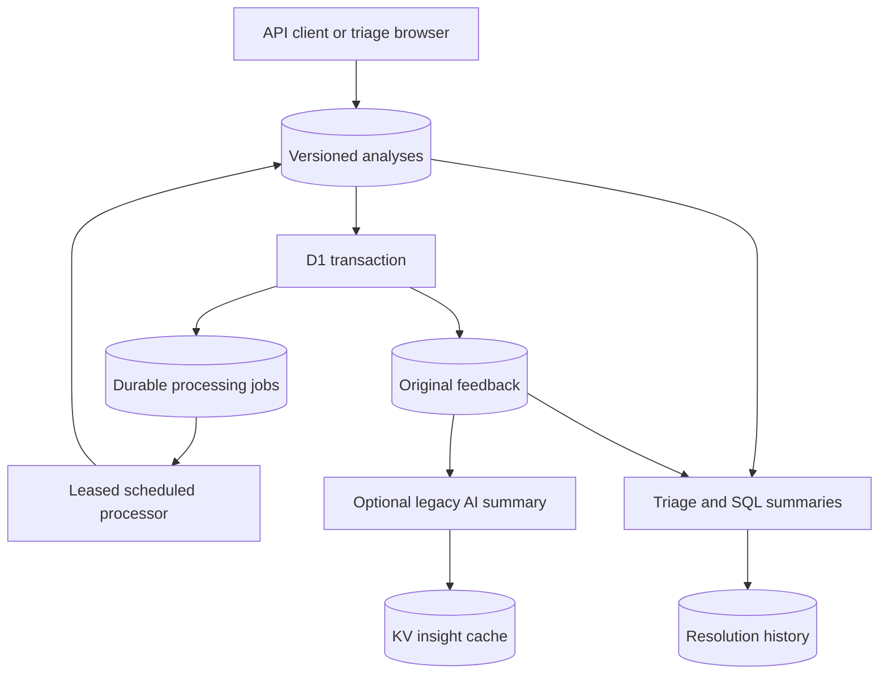

# Feedback Analyzer

**A feedback intake and triage service built with TypeScript, Cloudflare Workers and D1.** Submit reports through an authenticated API, inspect their processing state, and resolve or reopen them in a browser.

The central guarantee is small but useful: feedback and its processing intent commit together. Retrying a submission with the same idempotency key produces one record and one job. Reusing a key for different content returns a conflict.

## Architecture



Original reports remain separate from processing state and human resolution history. The `/triage` page shows the most recent 100 reports, their pending analysis state, and resolve/reopen controls. The original dashboard at `/` provides aggregate views and optional AI insights. A scheduled worker claims durable jobs, validates model output and writes versioned analyses. Pending, processing, completed and failed states remain visible; failed jobs can be explicitly replayed.

## Run locally

Use Node.js 24 and npm:

```bash
npm ci
cp .dev.vars.example .dev.vars
# Edit .dev.vars to set a long, unique DASHBOARD_PASSWORD.
npx wrangler d1 migrations apply feedback-db --local
npm run dev
```

Open `/triage` at the local URL. The browser prompts for username `analyst` and your configured password. Without `DASHBOARD_PASSWORD`, the service returns 503; incorrect or absent credentials return 401. Every route, including reporter history and AI insights, is protected. Use HTTPS outside localhost. This is shared single-team access, not individual accounts or tenant isolation.

Optional synthetic fixtures: `npx wrangler d1 execute feedback-db --local --file=./schema.sql`. This inserts examples every time it runs; do not repeatedly seed a shared database. The migration also upgrades the original feedback schema without deleting its records. Apply it through Wrangler migrations, which records successful application; do not manually rerun the ALTER statements.

Cloudflare resource IDs in `wrangler.jsonc` belong to the original project. A deployment needs its own resources, deliberate remote migration, and `wrangler secret put DASHBOARD_PASSWORD`. No remote migration, secret change or deployment is performed by the tests. Workers AI can access a paid remote resource even during local development; `/triage` does not call it.

## Submit and triage

```bash
curl --user analyst \
  -H 'Content-Type: application/json' \
  -H 'Idempotency-Key: demo-report-1' \
  -d '{"title":"Slow search","description":"Search takes several seconds","source":"manual"}' \
  http://localhost:8787/api/feedback
```

Curl prompts for the password. Retry with the same key and content to receive the same ID. Change the content with that key to see HTTP 409. Open `/triage`, resolve the report, refresh, then reopen it. SQL summaries reflect committed changes immediately; summary KV caching was removed to avoid stale counts and write/invalidation races. Optional AI insights are cached for 600 seconds per exact recent-feedback snapshot and prompt/model version. Each request reads up to 20 reports, including resolution status, before hashing the input. A late inference result can only populate its own snapshot key; it cannot overwrite a newer snapshot. This trades a bounded D1 read per request for freshness and does not deduplicate simultaneous inference on the same cache miss. Insights remain advisory, not authoritative triage state.

| Endpoint | Method | Behavior |
|---|---|---|
| `/api/feedback` | POST | Validated submission and atomic pending job; 202 |
| `/api/feedback/:id` | GET | Detail and reporter history for authenticated analysts |
| `/api/feedback/:id/status` | POST | `{"status":"resolved"}` or `{"status":"open"}`; records transitions |
| `/api/triage` | GET | Latest 100 reports, processing state and analysis, without response caching |
| `/api/feedback/:id/replay` | POST | Requeue a terminally failed job |
| `/api/processing` | GET | Counts, attempt totals and oldest creation time by processing state |
| `/api/stats`, `/api/top-issues`, `/api/recent` | GET | SQL summaries and recent records |
| `/api/repeat-users`, `/api/longest-unresolved` | GET | Reporter and age summaries |
| `/api/processing/health` | GET | Uncached current job counts, ready/delayed work, expired leases, retries and oldest active age |
| `/api/ai-insights` | GET | Optional generated summary, cached for 600 seconds |

Request bodies are limited to 16 KiB while streaming, with title/description/source limits of 200/8000/80 characters. Cross-site browser requests are rejected; there is no wildcard CORS. Authenticated responses use `Cache-Control: no-store`. The browser retains a submission's idempotency key for retries until success or content changes; this key is not persisted across page reloads.

## Verification

```bash
npm run typecheck
npm run test:security
npm test -- --run
npx wrangler deploy --dry-run
npm audit
```

CI runs source and test type checks, Node security regressions, local Workers/D1 integration tests and an npm audit gate for moderate-or-higher advisories, including development dependencies. Tests cover concurrent duplicate submissions, mismatched idempotency payloads, rollback on job-write failure, input limits, authentication, cross-site rejection, resolve/reopen history and summary freshness. Tests use synthetic data and do not invoke remote inference. The dependency update reports zero npm advisories at its verification date; this is not a guarantee against future advisories.

The Cloudflare test toolchain currently pins affected transitive versions. Scoped npm overrides select Zod 4.6.6 for `@cloudflare/vitest-plugin` and Undici 7.30.1 for Miniflare. Remove these overrides once upstream pins patched versions, then rerun `npm ci`, the tests, type checks and audit. Vitest remains on its compatible version 4 line; no major-version downgrade is required to clear the audit.

## Next milestones and trade-offs

- Evaluate model output on labeled reports and add human corrections/semantic issue suggestions. Current model output is validated structurally, not proven accurate.
- Add individual identities, rate limits and audit attribution before broader organizational use. Shared credentials cannot identify which analyst resolved a report.
- Add pagination, semantic issue grouping and human corrections. Exact title grouping currently remains a dashboard summary, not an issue entity.
- Evaluate analysis quality on labeled data before claiming useful classifications. Existing sentiment values are fixtures, and the 8/5/2 display mapping is not calibrated satisfaction.

[Demo](docs/demo.md) · [Design decisions](docs/project-overview.md)

## Durable processing

A minute cron invokes the processor for at most five jobs per invocation. D1 is both the durable work store and the claim boundary: an atomic update grants a 60-second lease with a unique token. Inference has a 20-second application timeout. Errors back off from one minute exponentially; five unsuccessful attempts reach a terminal failed state. Expired leases are reclaimable, including after a worker restart. The triage page exposes a retry button for failed jobs.

The analysis key includes feedback ID, the accepted input fingerprint, model ID and prompt version. Completion and job state commit together, and writes require the current lease and matching input fingerprint. A late worker cannot overwrite a newer attempt. Generated interpretations do not overwrite original feedback or human resolution decisions. Reports are currently immutable through the API; the fingerprint fence is also tested against a simulated input change.

This implementation polls D1 directly; it does not require Cloudflare Queues or claim queue-delivery testing. If a queue is added later, D1 should remain the recovery source of truth. Throughput is intentionally bounded and unbenchmarked. Provider timeouts may leave an upstream inference running, but late results are not persisted by the timed-out attempt.

Tests inject controlled model responses, failures, stale leases and duplicate work. Real inference and cron delivery are not tested against a deployed Cloudflare account. For local scheduled-handler testing, run Wrangler with `--test-scheduled` and invoke its local scheduled endpoint deliberately; this can call remote Workers AI. Normal `/triage` reads do not invoke inference. Configure the secret and apply both migrations before deployment.


### Processing visibility

The `/triage` page refreshes processing health alongside its reports. The health endpoint uses one D1 aggregate query for a consistent snapshot: pending and processing counts, completed and failed jobs, pending work ready now versus delayed by backoff, and expired processing leases. Expired leases are a subset of processing jobs; they are recovered or moved to terminal failure by the next processor invocation, not by reading this endpoint.

`oldest_active_age_seconds` measures time since submission for pending/processing jobs, including backoff; it is `null` when there is no active backlog. Failed jobs require explicit replay and appear separately. `retried_jobs` counts current job rows with more than one attempt, including completed/failed jobs; replay resets attempts, so it is not a lifetime retry or usage counter. Health reads are authenticated and uncached. They do not claim inference throughput, model quality, or deployed monitoring coverage.


### Human review and correction history

Apply migration `0003_corrections.sql` through the existing migration command before running the updated worker. On `/triage`, expand **Review or correct analysis**, edit sentiment/category/summary, provide a reason, and save. The model output remains separately visible. Corrections are append-only through the API and do not overwrite original feedback, generated analyses or resolution decisions.

`POST /api/feedback/:id/corrections` accepts `sentiment`, `category`, `summary`, `reason` (1–500 characters), `input_hash` and `expected_revision` from the current triage row. A single conditional insert verifies the current input hash and latest correction revision, then appends the next revision. Concurrent or stale saves return 409; refresh and review before retrying. A lost response does not create a duplicate revision on retry: the old expected revision conflicts, so inspect history to determine whether the first save succeeded.

`GET /api/feedback/:id/corrections` returns the newest 100 history entries, including their input hashes. Triage displays only the latest correction for the current input; earlier-input corrections remain in history. Later model processing cannot erase a human correction. Legacy fixtures without an input hash are not editable through this workflow. All routes use the existing shared analyst authentication, so this is not named-reviewer attribution or a tamper-proof audit log. Corrections are shown in triage; legacy aggregate charts and AI insights still describe original reports and do not incorporate reviewed labels. No labeled model-quality evaluation is claimed.

### Browsing older reports

Triage displays 100 reports per page, newest first. Use **Older reports** and
**Newer reports** to navigate; Refresh and triage actions retain the current page.
A new submission returns to the newest page. Failed page requests retain the
visible reports and can be retried.

`GET /api/triage?before=<feedback-id>` returns reports with IDs strictly below
that cursor, in descending order. The response remains a JSON array; use the last
ID of a full 100-row page for the next request. A shorter or empty page ends the
list. Concurrent inserts do not shift older pages, but this is not a historical
snapshot: processing and resolution state remain live. Authentication is required.
