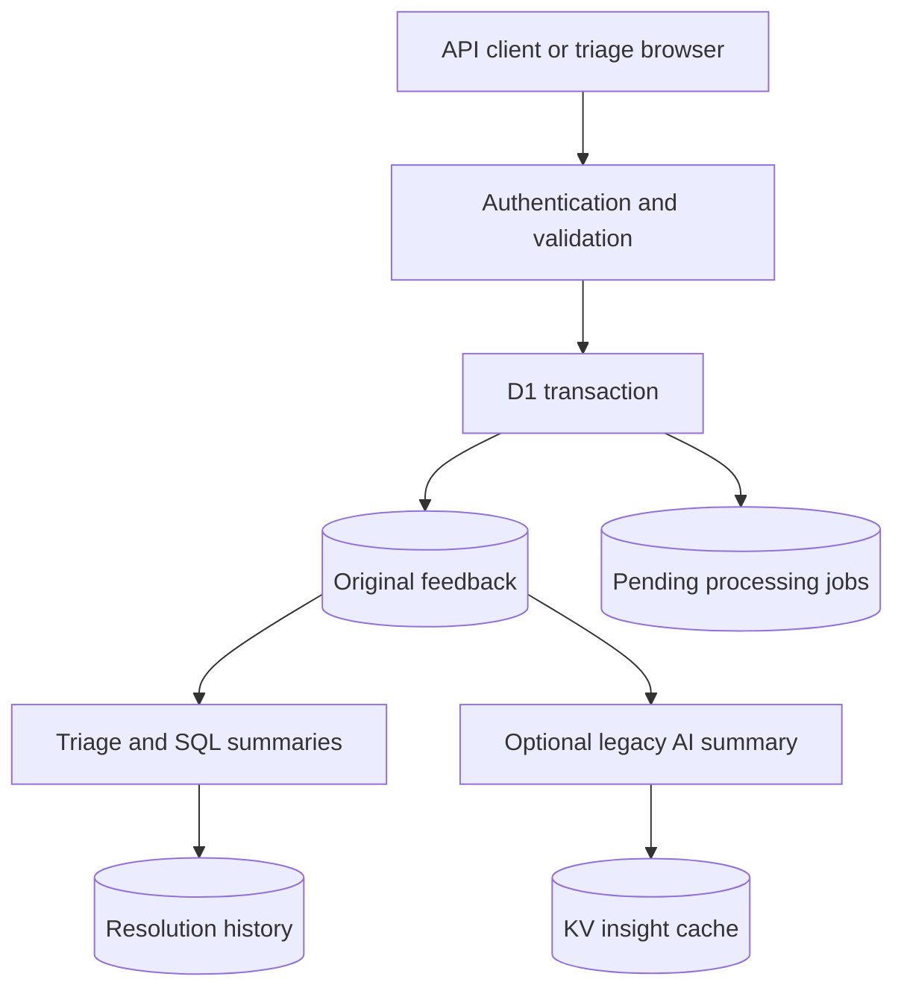

# Feedback Analyzer

**A feedback intake and triage service built with TypeScript, Cloudflare Workers and D1.** Submit reports through an authenticated API, inspect their processing state, and resolve or reopen them in a browser.

The central guarantee is small but useful: feedback and its processing intent commit together. Retrying a submission with the same idempotency key produces one record and one job. Reusing a key for different content returns a conflict.

## Architecture



Original reports remain separate from processing state and human resolution history. The `/triage` page shows the most recent 100 reports, their pending analysis state, and resolve/reopen controls. The original dashboard at `/` provides aggregate views and optional AI insights. **This milestone persists jobs but does not yet dispatch or process them.** Pending means pending; no analysis is fabricated.

## Run locally

Use Node.js 24 and npm:

```bash
npm ci
cp .dev.vars.example .dev.vars
# Edit .dev.vars to set a long, unique DASHBOARD_PASSWORD.
npx wrangler d1 migrations apply feedback-db --local
npm run dev
```

Open `/triage` at the local URL. The browser prompts for username `analyst` and your configured password. Without `DASHBOARD_PASSWORD`, the service returns 503; incorrect or absent credentials return 401. Every route, including reporter history and AI insights, is protected. Use HTTPS outside localhost. This is shared single-team access, not individual accounts or tenant isolation.

Optional synthetic fixtures: `npx wrangler d1 execute feedback-db --local --file=./schema.sql`. This inserts examples every time it runs; do not repeatedly seed a shared database. The migration also upgrades the original feedback schema without deleting its records. Apply it through Wrangler migrations, which records successful application; do not manually rerun the ALTER statements.

Cloudflare resource IDs in `wrangler.jsonc` belong to the original project. A deployment needs its own resources, deliberate remote migration, and `wrangler secret put DASHBOARD_PASSWORD`. No remote migration, secret change or deployment is performed by the tests. Workers AI can access a paid remote resource even during local development; `/triage` does not call it.

## Submit and triage

```bash
curl --user analyst \
  -H 'Content-Type: application/json' \
  -H 'Idempotency-Key: demo-report-1' \
  -d '{"title":"Slow search","description":"Search takes several seconds","source":"manual"}' \
  http://localhost:8787/api/feedback
```

Curl prompts for the password. Retry with the same key and content to receive the same ID. Change the content with that key to see HTTP 409. Open `/triage`, resolve the report, refresh, then reopen it. SQL summaries reflect committed changes immediately; summary KV caching was removed to avoid stale counts and write/invalidation races. Optional legacy AI insights retain their 600-second cache and are not authoritative triage state.

| Endpoint | Method | Behavior |
|---|---|---|
| `/api/feedback` | POST | Validated submission and atomic pending job; 202 |
| `/api/feedback/:id` | GET | Detail and reporter history for authenticated analysts |
| `/api/feedback/:id/status` | POST | `{"status":"resolved"}` or `{"status":"open"}`; records transitions |
| `/api/triage` | GET | Latest 100 reports and processing state, without response caching |
| `/api/stats`, `/api/top-issues`, `/api/recent` | GET | SQL summaries and recent records |
| `/api/repeat-users`, `/api/longest-unresolved` | GET | Reporter and age summaries |
| `/api/ai-insights` | GET | Optional generated summary, cached for 600 seconds |

Request bodies are limited to 16 KiB while streaming, with title/description/source limits of 200/8000/80 characters. Cross-site browser requests are rejected; there is no wildcard CORS. Authenticated responses use `Cache-Control: no-store`. The browser retains a submission's idempotency key for retries until success or content changes; this key is not persisted across page reloads.

## Verification

```bash
npm run typecheck
npm run test:security
npm test -- --run
npx wrangler deploy --dry-run
npm audit
```

CI runs source and test type checks, Node security regressions and local Workers/D1 integration tests. Tests cover concurrent duplicate submissions, mismatched idempotency payloads, rollback on job-write failure, input limits, authentication, cross-site rejection, resolve/reopen history and summary freshness. Tests use synthetic data and do not invoke remote inference. The dependency update reports zero npm advisories at its verification date; this is not a guarantee against future advisories.

## Next milestones and trade-offs

- Add asynchronous dispatch, leased processing, retries, replay and validated versioned analyses; jobs currently remain pending.
- Add individual identities, rate limits and audit attribution before broader organizational use. Shared credentials cannot identify which analyst resolved a report.
- Add pagination, semantic issue grouping and human corrections. Exact title grouping currently remains a dashboard summary, not an issue entity.
- Evaluate analysis quality on labeled data before claiming useful classifications. Existing sentiment values are fixtures, and the 8/5/2 display mapping is not calibrated satisfaction.

[Demo](docs/demo.md) · [Design decisions](docs/project-overview.md)
