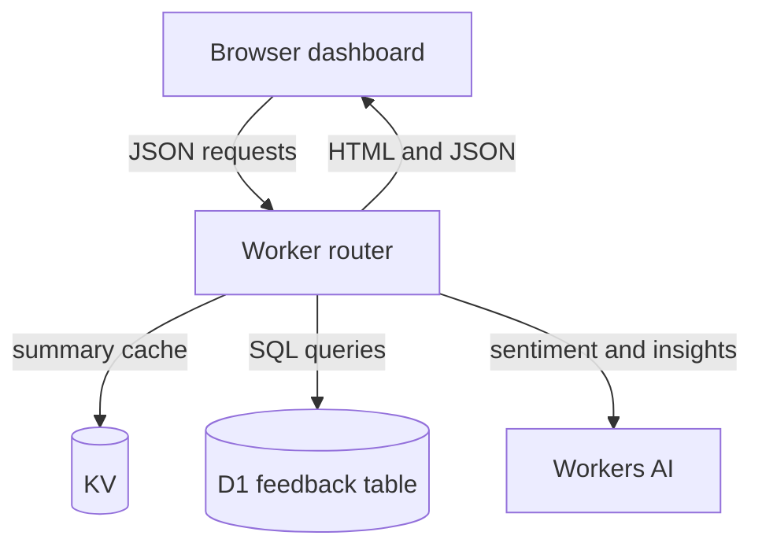

# Feedback Analyzer

**A TypeScript dashboard that queries feedback in Cloudflare D1, caches summaries in KV, and requests model-generated insights through Workers AI.**

Product teams need to spot repeated complaints and aging issues without reading every entry. This prototype makes those patterns visible through SQL summaries and a browser dashboard. Its data sources are seeded examples; Discord, GitHub and Twitter are labels, not connected ingestion integrations.

- Rank unresolved issues by identical title, inspect recent feedback and open individual records.
- Find repeat reporters and the oldest unresolved entries using relational queries.
- Cache four summary endpoints for five minutes and AI insights for ten minutes.
- Generate sentiment during API seeding and request an AI summary of up to 20 entries from the past seven days.

**Contribution:** Albert Mejooli authored the initial application commit and subsequent documentation; see [implementation history](https://github.com/Albert-bit07/feedback-analyzer/commits/main/src/index.ts). This personal project is not evidence of internal Cloudflare work.

**Stack:** TypeScript · Cloudflare Workers · D1/SQLite · KV · Workers AI · inline HTML/JavaScript · Tailwind CDN.

[90-second demo plan](docs/demo.md) · [Engineering decisions and validation](docs/project-overview.md) · [Recruiting materials](docs/recruiting.md)

## Architecture



This is an illustrative source-derived architecture, not a captured deployment. The [Worker](src/index.ts) serves both the page and API. The browser refreshes its panels every 30 seconds; that does not bypass cached responses. On cache misses, summary handlers query D1 and populate KV. Recent records and detail views query D1 directly. The AI summary uses recent rows and caches successful output for 600 seconds.

## Run locally

Prerequisites: Node.js compatible with the locked Wrangler version, npm, and a Cloudflare account only if exercising remote Workers AI. Run from this repository root:

```bash
npm ci
npx wrangler d1 execute feedback-db --local --file=./schema.sql
npm run dev
```

Open the local URL printed by Wrangler. `schema.sql` creates the table and inserts sample rows: running it again adds duplicates. Use a fresh disposable checkout for a recording. Do not call `/api/seed` on a shared deployment: it mutates D1, clears shared cache keys, and can invoke billable remote AI. Local development is not a guarantee that every binding runs offline; confirm Wrangler's AI behavior and account before enabling it.

The committed [Wrangler configuration](wrangler.jsonc) refers to the author's resource IDs. For your own deployment, create your own D1 database and KV namespace, update a local configuration with their identifiers, bind Workers AI, initialize the remote schema deliberately, and review the security gaps below before considering `npm run deploy`. No deployment was performed for this review.

## API and implementation

| Route | Behavior | Cache |
|---|---|---|
| `/api/stats` | Total, unresolved, mapped sentiment average, repeat reporters | 300 s |
| `/api/top-issues` | Five unresolved titles grouped by exact text | 300 s |
| `/api/recent` | Five newest entries | None |
| `/api/repeat-users` | Five reporters with multiple unresolved records | 300 s |
| `/api/longest-unresolved` | Five oldest unresolved entries | 300 s |
| `/api/feedback/:id` | Record and up to ten entries from the same reporter | None |
| `/api/ai-insights` | Summary of up to 20 recent entries | 600 s on success |
| `/api/seed` | Inserts mock entries with sentiment analysis | Clears summary keys first |

Routes other than OPTIONS are selected by path, without HTTP-method enforcement. There is no general feedback ingestion, login, resolution or deletion endpoint. The schema contains fields not exposed as workflows.

## Engineering decisions and limitations

D1 supports grouping, ordering and reporter history without scanning all rows in application code. KV trades freshness for fewer repeated queries; no benchmark establishes a latency improvement. The previous README's 400 ms/75 ms figures have been removed because no supporting raw experiment was found.

Sentiment calls `@cf/huggingface/distilbert-sst-2-int8`, truncates input to 500 characters, and assumes top-level label/score fields; model response compatibility needs validation. A caught exception falls back to keywords, while an unexpected response shape may become neutral. Insights call `@cf/meta/llama-3-8b-instruct`. These are inference integrations, not trained or evaluated models. The sentiment display maps labels to 8/5/2 rather than measuring calibrated satisfaction.

**Use synthetic data and trusted local access.** No authentication, rate limiting or tenant isolation is implemented. Reporter emails are returned by APIs; CORS is unrestricted; several dashboard values reach `innerHTML` or inline handlers without context-safe escaping. The seed route can be invoked by GET and repeatedly inserts duplicates. The AI failure message says cached data is used even when no cached summary was returned. Do not expose this prototype to untrusted data or public traffic without addressing these issues.

## Validation

On 2026-10-20, `npm ci --ignore-scripts`, `npx tsc --noEmit`, and Wrangler's dry-run bundle completed successfully in the review environment. No deployment or AI request was made. `npm test -- --run` failed before collecting tests because Workers tooling could not enumerate network interfaces (`uv_interface_addresses`). The [existing tests](test/index.spec.ts) still assert the starter “Hello World!” response, so even a runnable suite is not application validation. No CI workflow is committed. See [scope and next checks](docs/project-overview.md).
